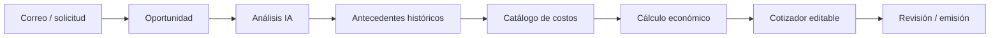

# ROMAX — Ruta maestra de cotización asistida por IA

**Fecha:** 18-nov-2026  
**Base:** transcripción de la reunión “Reunión - Cotizaciones en automático” + estado técnico actual de One Facility / ROMAX.

## 1. Objetivo

Redirigir el piloto de One hacia un asistente de cotización que reduzca la carga de trabajo y el riesgo de errores, llevando una solicitud comercial desde su entrada hasta una cotización revisable.

La transcripción plantea tres capacidades centrales: cargar el histórico de cotizaciones, extraer automáticamente solicitudes desde el correo de ventas y permitir que el usuario genere cotizaciones con asistencia de IA.

## 2. Ruta objetivo



### Qué ocurre en cada etapa

1. **Correo / solicitud:** detectar la oportunidad y sus archivos.
2. **Oportunidad:** registrar cliente, sede, contacto y estado.
3. **Análisis IA:** identificar alcance, materiales, equipos, mano de obra y datos faltantes.
4. **Antecedentes:** encontrar cotizaciones históricas comparables.
5. **Catálogo:** consultar recursos, proveedores, tarifas y alternativas.
6. **Cálculo:** aplicar las reglas económicas de forma determinista.
7. **Cotizador:** producir un borrador editable con estructura ROMAX.
8. **Revisión / emisión:** validación humana, PDF y seguimiento.

## 3. Priorización por valor

### ⭐⭐⭐⭐⭐ Máxima prioridad

- **R1-D3:** certificación del histórico de 25 cotizaciones.
- **R2:** catálogo independiente de costos.
- **R2+:** clientes, sedes y contactos.
- **R3:** bandeja Gmail / oportunidades.
- **R4-A:** análisis técnico con IA.
- **R4-B:** comparación con histórico.
- **R4-C:** motor económico determinista.
- **R4-D:** constructor editable de cotización.
- **R6:** PDF, emisión y trazabilidad.

### ⭐⭐⭐⭐ Alta prioridad

- R5: visita técnica integrada.
- Fotos, medidas, cantidades y horas-hombre que alimenten el cotizador.
- Proveedores y alternativas de costo.
- Versionado y vigencia de tarifas.

### ⭐⭐ Backlog

- CRM completo.
- Dashboards comerciales avanzados.
- Automatizaciones de aprobación no definidas.
- Envío automático de correos antes de establecer las reglas operativas.

## 4. Orden maestro recomendado

```
R1-D3
  ↓
R2 mínimo viable
  ↓
R3 — entrada automática desde Gmail
  ↓
R4 — primer vertical slice de cotización
  ↓
R6 — PDF / emisión / trazabilidad
  ↓
R5 — visita técnica integrada
  ↓
mejoras y automatizaciones avanzadas
```

### Por qué este orden

R2 no debe convertirse en el objetivo del proyecto. Su función es proporcionar el motor de costos que necesita R4.

El primer gran hito demostrable debe ser:

> **Correo recibido → oportunidad → análisis IA → antecedentes → costos → borrador de cotización revisable.**

## 5. Primer vertical slice para presentar al cliente

### Paso 1 — Llega una solicitud
One detecta el correo y sus archivos.

### Paso 2 — Se crea la oportunidad
Cliente, sede, contacto y estado quedan registrados.

### Paso 3 — La IA entiende la solicitud
Resume alcance, materiales, equipos, mano de obra y datos faltantes.

### Paso 4 — Encuentra antecedentes
Muestra cotizaciones históricas similares sin confundirlas con costos vigentes.

### Paso 5 — Construye la economía
Utiliza tarifas y alternativas del catálogo y mantiene trazabilidad de las fuentes.

### Paso 6 — Entrega el borrador
El usuario revisa, ajusta y genera la propuesta ROMAX.

## 6. Guardrails

- **Histórico ≠ costo:** los precios históricos son referencia; no se copian automáticamente a tarifas.
- **IA ≠ calculadora:** la IA interpreta y propone; One conserva las reglas y cálculos.
- **Fuente obligatoria:** una tarifa debe explicar origen, fecha y moneda.
- **Comparación ≠ recomendación:** la alternativa más barata no se aprueba automáticamente.
- **Aprobación posterior:** los umbrales automáticos quedan en backlog hasta existir una política real aprobada.
- **Simplicidad:** el catálogo debe ser pequeño y usable antes de crecer hacia procesos tipo ERP.

## 7. Estado actual

R1 ya cuenta con 25 cotizaciones históricas estructuradas.

R2 está en construcción. El seed controlado derivado del piloto incorporó 35 recursos normalizados sin convertir precios históricos en tarifas.

El PR actual de R2A/R2C permanece abierto como trabajo de la rama `feature/romax-r2a-cost-catalog`.

## 8. Criterio de éxito

El proyecto debe considerarse exitoso cuando una solicitud real pueda recorrer el flujo completo y producir una cotización revisable con:

- antecedentes trazables;
- costos provenientes de fuentes identificables;
- cálculos consistentes;
- estructura comercial ROMAX;
- intervención humana antes de la emisión cuando corresponda.


## 10. R2-E2.1 — Seguridad y permisos (27-nov-2026)

Antes de cargar precios se implementa una capa de capacidades explícitas por usuario. Logística puede registrar costos con `market_cost.manage`; un validador distinto puede aprobar/rechazar con `market_cost.validate`; `market_cost.read` permite solo consulta; `pricing_rules.manage` gobierna la configuración FX. Owner/admin administran concesiones. La UI no sustituye RLS.

El costo de adquisición no se muestra a miembros sin capacidad, aunque intenten consultar directamente la API. El precio de venta ROMAX permanece separado y sus capacidades quedan reservadas hasta R2-E2.5. PR #128 contiene migración, pgTAP, UI y CI. Cloud apply, carga económica, merge y producción quedan fuera de esta autorización.

## CI integral — PASS (27-nov-2026)

Ejecución verificada en el PR #128 y en el push de la rama, ambos sobre el commit `2a9074404c98b4205af3397524538e8506bf7c0d`.

- GitHub Actions PR run: https://github.com/AlexisCasas/assetlink-connect-84223-8e482395/actions/runs/46023394263
- GitHub Actions push run: https://github.com/AlexisCasas/assetlink-connect-84223-8e482395/actions/runs/46023382222
- Supabase aislado/no vinculado a Cloud: cadena completa de migraciones y 37 archivos pgTAP, 2,874 aserciones; `Result: PASS`.
- Regresión R2A: 22/22 aserciones.
- R2-E2.1 multiempresa: 38/38 aserciones.
- Frontend: TypeScript sin diagnósticos nuevos (se mantiene la línea base heredada de Index.tsx), ESLint, contrato estático de seguridad y Vite build: PASS.
- El stack local desechable se detuvo con `supabase stop --no-backup`: PASS.

Correcciones que quedaron cubiertas por el CI:
1. Sintaxis de dollar-quoting en pruebas pgTAP.
2. Identidad del usuario creador del costo en el fixture multiempresa.
3. Prueba de denegación de concesiones por un usuario no admin, diferenciando el guard de procedencia de la política RLS.
4. Preflight con planes explícitos de 22 y 38 pruebas y control estático para evitar dollar-quoting mal formado.

**Alcance no ejecutado:** no se aplicó la migración en Supabase Cloud, no se cambiaron concesiones reales, no se importaron precios ni históricos, no se hizo merge y no se desplegó a producción. El PR #128 permanece abierto y en Draft para revisión.
