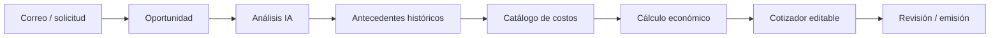

# ROMAX — Ruta maestra de cotización asistida por IA

**Fecha:** 18-nov-2026  
**Base:** transcripción de la reunión “Reunión - Cotizaciones en automático” + estado técnico actual de One Facility / ROMAX.

## 1. Objetivo

Redirigir el piloto de One hacia un asistente de cotización que reduzca la carga de trabajo y el riesgo de errores, llevando una solicitud comercial desde su entrada hasta una cotización revisable.

La transcripción plantea tres capacidades centrales: cargar el histórico de cotizaciones, extraer automáticamente solicitudes desde el correo de ventas y permitir que el usuario genere cotizaciones con asistencia de IA.

## 2. Ruta objetivo



### Qué ocurre en cada etapa

1. **Correo / solicitud:** detectar la oportunidad y sus archivos.
2. **Oportunidad:** registrar cliente, sede, contacto y estado.
3. **Análisis IA:** identificar alcance, materiales, equipos, mano de obra y datos faltantes.
4. **Antecedentes:** encontrar cotizaciones históricas comparables.
5. **Catálogo:** consultar recursos, proveedores, tarifas y alternativas.
6. **Cálculo:** aplicar las reglas económicas de forma determinista.
7. **Cotizador:** producir un borrador editable con estructura ROMAX.
8. **Revisión / emisión:** validación humana, PDF y seguimiento.

## 3. Priorización por valor

### ⭐⭐⭐⭐⭐ Máxima prioridad

- **R1-D3:** certificación del histórico de 25 cotizaciones.
- **R2:** catálogo independiente de costos.
- **R2+:** clientes, sedes y contactos.
- **R3:** bandeja Gmail / oportunidades.
- **R4-A:** análisis técnico con IA.
- **R4-B:** comparación con histórico.
- **R4-C:** motor económico determinista.
- **R4-D:** constructor editable de cotización.
- **R6:** PDF, emisión y trazabilidad.

### ⭐⭐⭐⭐ Alta prioridad

- R5: visita técnica integrada.
- Fotos, medidas, cantidades y horas-hombre que alimenten el cotizador.
- Proveedores y alternativas de costo.
- Versionado y vigencia de tarifas.

### ⭐⭐ Backlog

- CRM completo.
- Dashboards comerciales avanzados.
- Automatizaciones de aprobación no definidas.
- Envío automático de correos antes de establecer las reglas operativas.

## 4. Orden maestro recomendado

```
R1-D3
  ↓
R2 mínimo viable
  ↓
R3 — entrada automática desde Gmail
  ↓
R4 — primer vertical slice de cotización
  ↓
R6 — PDF / emisión / trazabilidad
  ↓
R5 — visita técnica integrada
  ↓
mejoras y automatizaciones avanzadas
```

### Por qué este orden

R2 no debe convertirse en el objetivo del proyecto. Su función es proporcionar el motor de costos que necesita R4.

El primer gran hito demostrable debe ser:

> **Correo recibido → oportunidad → análisis IA → antecedentes → costos → borrador de cotización revisable.**

## 5. Primer vertical slice para presentar al cliente

### Paso 1 — Llega una solicitud
One detecta el correo y sus archivos.

### Paso 2 — Se crea la oportunidad
Cliente, sede, contacto y estado quedan registrados.

### Paso 3 — La IA entiende la solicitud
Resume alcance, materiales, equipos, mano de obra y datos faltantes.

### Paso 4 — Encuentra antecedentes
Muestra cotizaciones históricas similares sin confundirlas con costos vigentes.

### Paso 5 — Construye la economía
Utiliza tarifas y alternativas del catálogo y mantiene trazabilidad de las fuentes.

### Paso 6 — Entrega el borrador
El usuario revisa, ajusta y genera la propuesta ROMAX.

## 6. Guardrails

- **Histórico ≠ costo:** los precios históricos son referencia; no se copian automáticamente a tarifas.
- **IA ≠ calculadora:** la IA interpreta y propone; One conserva las reglas y cálculos.
- **Fuente obligatoria:** una tarifa debe explicar origen, fecha y moneda.
- **Comparación ≠ recomendación:** la alternativa más barata no se aprueba automáticamente.
- **Aprobación posterior:** los umbrales automáticos quedan en backlog hasta existir una política real aprobada.
- **Simplicidad:** el catálogo debe ser pequeño y usable antes de crecer hacia procesos tipo ERP.

## 7. Estado actual

R1 ya cuenta con 25 cotizaciones históricas estructuradas.

R2 está en construcción. El seed controlado derivado del piloto incorporó 35 recursos normalizados sin convertir precios históricos en tarifas.

El PR actual de R2A/R2C permanece abierto como trabajo de la rama `feature/romax-r2a-cost-catalog`.

## 8. Criterio de éxito

El proyecto debe considerarse exitoso cuando una solicitud real pueda recorrer el flujo completo y producir una cotización revisable con:

- antecedentes trazables;
- costos provenientes de fuentes identificables;
- cálculos consistentes;
- estructura comercial ROMAX;
- intervención humana antes de la emisión cuando corresponda.


## 10. R2-E2.1 — Seguridad y permisos (27-nov-2026)

R2-E2.1 implementado, revisado y aplicado en Supabase Cloud OneFacility. El PR #128 permanece abierto y en Draft.

- Capacidades por usuario: `market_cost.read`, `market_cost.manage`, `market_cost.validate`, `pricing_rules.manage`.
- Owner/admin administran concesiones; revocación irreversible y auditada. Las capacidades comerciales de precio de venta quedan reservadas.
- RLS limita costos de adquisición y proveedores; el creador no puede aprobar/rechazar su propio costo. Las operaciones de inserción exigen membresía activa.
- La tabla de auditoría no permite DELETE/TRUNCATE al service_role.
- Migraciones aplicadas: `20261127154749_romax_r2e2_1_pricing_access_security` y `20261127155628_romax_r2e2_1_service_role_privilege_hardening`.
- CI: 37 archivos pgTAP / 2,882 aserciones; R2A 22/22, R2-E2.1 46/46; TypeScript, ESLint, contrato estático y Vite PASS.
- Evidencias: [PR run](https://github.com/AlexisCasas/assetlink-connect-84223-8e482395/actions/runs/46029672570) y [push run](https://github.com/AlexisCasas/assetlink-connect-84223-8e482395/actions/runs/46029661761).

Cloud conserva 2 tarifas, 1 proveedor y 1 configuración FX; no se crearon concesiones automáticas ni se importaron precios/históricos. ROMAX solo tiene un owner activo; hace falta añadir un segundo miembro para asignarle `market_cost.validate`. Las dos tarifas previas (una approved y otra rejected) fueron revisadas por su creador antes de la regla nueva y no se modificaron.

No merge, no importación económica y no despliegue productivo. Los PRs #122/#123 deben alinear sus ramas con las versiones de migración ya aplicadas antes de completar el merge de la cadena.


## Actualización vigente — 27-nov-2026

HOM-01–04 cerrados; catálogo técnico y R2-E2.1 productivos, correctivo visual #129 mergeado y desplegado en a5483db (QA-01 8/8 según usuario, CI 5/5). La etapa de aprobación comercial continúa pendiente: propietario único, sin nuevos perfiles, y el guard de autoaprobación aún bloquea sus propias tarifas. No se han importado costos/históricos de mercado. La ruta crítica detallada y sus gates se mantienen en [Plan maestro, estado vigente](ROMAX_PILOT_MASTER_PLAN.md#estado-vigente-y-ruta-crítica--27-nov-2026-sustituye-estados-pendientes-históricos). Secuencia: R2-E2.1B (resolver operación owner único) → E2.2–E2.7 → R4-C → R4-D → R4-E → R6; R4-B en paralelo; R3 Gmail y R5 no bloquean el piloto manual. R4-A/A.1 y oportunidades manuales ya desplegados. IA sugiere, One calcula, propietario revisa; sin aprobación ni envío automático. Esta actualización prevalece sobre estados históricos anteriores.
